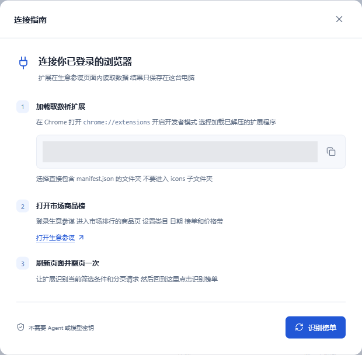
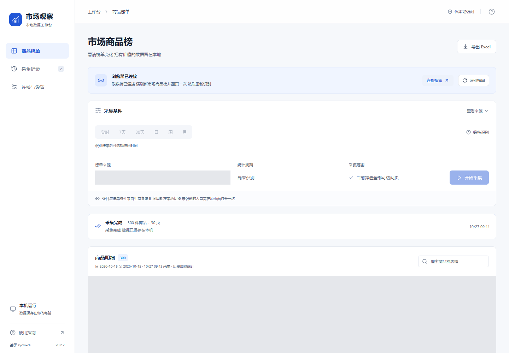

# 市场观察本地工作台｜安装与使用手册

适用版本：Windows v0.2.2 · 取数桥扩展 1.0.0

适用读者：没有编程经验，希望把生意参谋市场商品排行保存为 Excel 的用户。核对日期：2026-10-27。

飞书在线版：https://waiunuasu7d.feishu.cn/docx/S2kXdj1pxodFUyxQISEcgje7nWb （由文档所有者管理访问权限）

使用目标：按顺序完成解压、启动、安装取数桥、连接生意参谋、选择日期、采集和导出。首次使用从头操作；已经装好后直接看“每次使用的简短清单”。本手册的标题可通过飞书目录导航。

## 使用前准备

- 一台 Windows 电脑和 Chrome 浏览器。取数桥要求 Chrome 116 或更新版本；旧版先更新。本文按 Chrome 桌面版说明。
- 可登录生意参谋、并能正常查看“市场 → 市场排行 → 商品”的账号。工具沿用账号现有权限，不能增加平台购买权限。
- 稳定网络和完整的 Windows 发布包。普通用户无需安装 Python、Node、Agent、MCP，也不需要模型 API 密钥。
- 一个长期保留的工具文件夹，例如 D 盘的“市场观察”。位置只是示例，可以选择自己电脑实际存在的盘符。

软件下载：打开 https://github.com/jinkaibao0529-web/sycm-cli/releases/tag/v0.2.2 ，在 Assets（资源）中选择“MarketWorkbench-Windows-v0.2.2.zip”。不要选择 Source code（源码），源码不是可直接双击运行的程序。无法访问 GitHub 时，向提供工具的人索取同版本完整发布包。

先认识三个对象：

| 对象 | 在哪里 | 有什么作用 |
| --- | --- | --- |
| 本地工作台 | 双击 MarketWorkbench.exe 后打开的页面 | 选择日期、采集、预览和导出 |
| 取数桥扩展 | Chrome 扩展页中的 taobao-cli 取数桥 | 把本地查询交给已登录的生意参谋页面 |
| 生意参谋 | Chrome 内的 sycm.taobao.com 页面 | 提供登录状态、账号权限和真实榜单数据 |

“搭桥”就是让三者连接。采集时本地程序、加载扩展的 Chrome 和生意参谋标签页都要保持打开。Excel 生成后可以独立使用。

## 下载与完整解压

1. 找到“MarketWorkbench-Windows-v0.2.2.zip”。不知道下载位置时，在 Chrome 按 Ctrl+J 打开下载记录，找到文件，再点击“在文件夹中显示”或文件夹图标。
2. 在压缩包上右键，选择“全部解压缩”；部分电脑显示“解压到…”。选择准备好的固定位置，完成解压。
3. 进入解压后的“市场商品榜”文件夹，确认有 MarketWorkbench.exe、_internal 文件夹、extension 文件夹和本手册。
4. 不要直接在压缩软件的预览窗口里运行，也不要只复制 exe；主程序需要同目录的其他文件。
5. 打开 extension → unpacked，确认这一层直接有 manifest.json、background.js、market-observer.js 和 icons 文件夹。稍后安装扩展就选择这一层。

如果 Windows 隐藏后缀，MarketWorkbench.exe 可能显示为 MarketWorkbench，manifest.json 可能显示为 manifest。可以在资源管理器的“查看”中开启“文件扩展名”。不要自己更改后缀。

成功标志：从普通文件夹能找到主程序和上述配套目录，不需要再进入压缩包。

## 第一次启动

1. 双击 MarketWorkbench.exe，稍等程序启动。
2. 程序会打开运行窗口，并自动打开 http://127.0.0.1:8765/ 。这个地址表示本机服务，不是需要购买的网站。
3. 如果网页没自动打开，在 Chrome 顶部地址栏手动输入 http://127.0.0.1:8765/ 并回车，不要输入到搜索框。
4. 看到“市场观察”和“市场商品榜”后，保持程序运行窗口打开，再继续安装扩展。

成功标志：页面有“商品榜单”“采集记录”“连接与设置”。第一次显示未连接浏览器是正常状态。

关闭网页只关闭页面；关闭程序运行窗口会停止本地服务。下次使用重新双击主程序。程序已经运行时，再次双击会打开已有工作台，不需要反复开多个窗口。

## 安装取数桥扩展

### 打开扩展管理页

1. 打开准备登录生意参谋的 Chrome。
2. 在地址栏输入 chrome://extensions 并回车。
3. 开启右上角“开发者模式”。开启后应出现“加载已解压的扩展程序”按钮，个别 Chrome 版本译名略有差异。

### 选择正确的目录

1. 点击“加载已解压的扩展程序”。
2. 在文件夹选择窗口中进入刚才完整解压的位置。
3. 依次进入“市场商品榜 → extension → unpacked”。
4. 停在 unpacked 这一层，点击“选择文件夹”。不要选压缩包、extension 上一层或 icons 下一层，也不用双击 manifest.json。
5. 回到扩展管理页，确认出现“taobao-cli 取数桥”，版本 1.0.0，开关处于开启状态。

工作台“连接指南”也会给出当前扩展路径。可点击复制按钮，粘贴到文件夹选择窗口顶部路径栏，按回车再选择文件夹。图中本机路径已遮盖，以你工作台显示的路径为准。

成功标志：有取数桥卡片且没有“无法加载清单”等错误。固定到工具栏不是必需操作。扩展名字是“taobao-cli 取数桥”，不是“市场观察”，属于正常情况。

保留加载扩展时选择的文件夹，Chrome 会继续从该目录读取文件。如果装过旧版取数桥，先停用旧卡片，只保留一份启用，避免多个扩展同时响应。

## 首次搭桥连接

1. 在安装扩展的同一个 Chrome 中打开 https://sycm.taobao.com/ ，登录账号。先在平台完成验证码或其他验证。
2. 进入“市场 → 市场排行”，选择“商品”。不要选成本店经营分析中的商品排行，那不是同一个榜单。
3. 在生意参谋选好类目、榜单类型、价格带、店铺类型和其他筛选，确认能看到目标商品列表。
4. 按 Ctrl+R 刷新榜单页，等列表加载完；如果有下一页，再翻一页并等待加载，让扩展识别接口和分页请求。
5. 回到工作台点击“识别榜单”。若找不到入口，可以打开“连接指南”或“连接与设置”。
6. 检查“榜单来源”和业务筛选，确认与生意参谋一致。同一条件的不同日期会合并成一个来源，不会显示一串日期样本。

成功标志：显示浏览器已连接，榜单来源可选择，对应时间入口可用。没有识别成功时先按排查表处理，不要直接开始采集。

### 首次识别六种时间入口

实时、7天、30天、日、周、月分别需要自己的接口模板。某入口提示尚未识别时，在生意参谋切换到该入口，等列表加载，再回工作台识别。按需要依次做完；平台无权限的入口需要先解决账号权限。

每种入口识别一次后，日、周、月的其他合法历史日期直接在本地选，不需要逐个去平台点击解锁。扩展按账号缓存不含凭据的模板，刷新或重启后可以恢复，仍需要保持平台页面打开。换账号、类目或其他业务筛选后，要重新识别相应条件。

## 选择统计时间

在时间栏点击入口，再核对显示的起止日期。

| 入口 | 操作 | 含义与限制 |
| --- | --- | --- |
| 实时 | 点击实时 | 单次快照，不自动刷新；逐页读取期间榜单可能变化 |
| 7天 | 点击7天 | 平台最新可用的7天窗口，不是任意指定7天 |
| 30天 | 点击30天 | 平台最新可用的30天窗口 |
| 日 | 点击日，选择或输入日期 | 默认北京时间昨天；未来或未结束日期不可采集 |
| 周 | 点击周，选择周或用前后箭头 | 默认最近结束的完整周，以显示的起止日期为准 |
| 月 | 点击月，选择月份 | 默认最近结束的完整月，未结束的当月不可作为历史月采集 |

日、月控件可点日历按钮，也可按浏览器支持的格式输入。周控件在不同 Chrome 版本中显示可能不同，选后务必核对起止日期。“上一周期”“下一周期”按当前日、周、月逐次切换。清空日期后，重新选好才能采集。

未知平台历史下限时，本地不会按“点过的最早日期”限制。但选中日期不代表平台一定有权限或数据。平台拒绝时显示实际提示，不会换到其他日期；正常空列表显示“该周期未返回商品数据”，不能只据此认定为过期或无权限。

例如查询2026年10月15日：点“日”，选择2026-10-15，核对范围，再开始。此处只是操作示例，实际请选择已经结束且平台支持的日期。

## 开始采集与停止

### 完成一次采集

1. 检查榜单来源、业务筛选、入口和统计范围。
2. 点击“开始采集”。同一时间只允许一个任务，已有任务运行时先等待或停止。
3. 查看已采集数量、页数和状态。工具逐页读取该条件下账号可访问的数据，并去重。
4. 保持本地程序、Chrome和生意参谋标签页打开，不退出或切换账号。建议当前任务结束后再更改平台筛选。
5. 等任务显示完成再导出。数量以实际返回为准，不能保证每个周期都有300件。

任务开始时已固定来源和日期。采集中切换本地时间栏只是在准备下一次任务，不改变正在执行的任务，也不改变已选中的历史预览。导出前看任务自身周期说明，不要只看上方时间栏。

### 需要提前停止时

点击停止采集按钮，等当前请求结束后停止，不一定立即完成。已有商品会保留，可以导出部分结果，文件名带“部分结果”；没有商品则不能导出。

登录异常、重复页或返回结构不支持时，会停止并提示原因。处理后重新识别并新建任务，不会自动接着旧任务补采。采集中关闭程序会造成中断，下次启动后会标明，部分结果不能当完整榜单。

## 预览与导出 Excel

### 查看当前和历史任务

商品表支持搜索和分页。搜索只影响屏幕预览；Excel始终导出所选任务全部已采集商品，不仅是当前页或搜索结果。“采集记录”可以查看旧任务和重新导出。

### 找到导出的文件

1. 等任务结束，确认有商品数据。
2. 点击“导出 Excel”，或到“采集记录”使用对应任务的导出按钮。
3. 浏览器弹出保存位置时，选择文件夹后保存；没有弹窗一般保存到浏览器配置的下载文件夹。
4. 按 Ctrl+J 查看下载记录，点击“在文件夹中显示”。双击 .xlsx，用 Excel 或兼容表格软件打开。

同名再次下载时，浏览器通常增加序号，以浏览器设置为准。工具不会主动覆盖你的本地文件。

### 文件名按所选统计日期生成

日期来自这个任务开始时选定的统计范围，不是下载当天，也不会跟随界面后来的时间切换。

| 周期 | 文件名示例 |
| --- | --- |
| 实时 | 市场商品榜_实时_2026-10-27_091829.xlsx |
| 7天 | 市场商品榜_7天_2026-10-20_2026-10-26.xlsx |
| 30天 | 市场商品榜_30天_2026-09-27_2026-10-26.xlsx |
| 日 | 市场商品榜_日_2026-10-15.xlsx |
| 周 | 市场商品榜_周_2026-10-19_2026-10-25.xlsx |
| 月 | 市场商品榜_月_2026-09.xlsx |

实时文件名091829表示任务创建时的北京时间09:18:29。取消、失败、中断后导出的已有商品，文件名增加“_部分结果”。旧任务无法解析日期时会写“日期未识别”和任务编号，不拿下载日期冒充。

### 认识工作簿内容

- “商品榜单”：商品ID、名称、店铺、关键词、排名、支付买家数区间、访客数区间等实际返回字段。平台未提供的字段留空。
- “采集说明”：任务状态、周期类型、统计范围、采集时间、来源页面和缺失字段。导出后先看这里确认是否完整。
- 商品链接、图片链接和来源页面都是蓝色下划线的原生超链接，可点击。表格软件可能要求确认打开，请按软件提示处理。
- 图片列保存网址，不内嵌图片。商品ID按文本保存，避免长数字被截短。
- “2.5万～5万”等区间保留平台原文，不代表精确销量，不能把上下限当确定成交量。

## 每次使用的简短清单

1. 双击主程序，确认工作台打开。
2. 在装有取数桥的Chrome打开生意参谋市场商品榜，确认仍登录且能看到列表。
3. 回工作台识别，核对来源和业务筛选。
4. 选择时间入口和日期，核对范围。
5. 开始采集，保持程序、Chrome、平台标签页打开。
6. 结束后导出，核对文件名和“采集说明”。
7. 不再采集时关闭程序运行窗口。历史任务保存在本机，下次从“采集记录”查看。

## 升级、移动目录与备份

### 更新程序和扩展

1. 等当前任务结束，或停止并确认状态更新；先导出重要结果。
2. 关闭旧程序运行窗口。
3. 完整解压新版到固定位置，可以用新版本文件夹，不要在程序运行中覆盖exe。
4. 扩展目录不变且文件更新后，在 chrome://extensions 的取数桥卡片点击重新加载/刷新图标，再刷新生意参谋页。
5. 如果新版放在另一目录，先停用旧取数桥，再加载新版 extension/unpacked，保留一份启用。
6. 启动新版，确认界面版本，再重新识别。

本版工作台v0.2.2，取数桥仍为1.0.0，两个版本号不要求一致。移动扩展目录后也需要重新加载新位置，主程序能打开不表示扩展已迁移。

### 历史记录保存与备份

默认历史数据保存在Windows当前用户的 %LOCALAPPDATA%\SycmMarket 文件夹，数据库名为market.db。把 %LOCALAPPDATA%\SycmMarket 粘贴到资源管理器地址栏并回车可查看。不要用文本编辑器修改数据库。

正常升级或移动程序目录不会主动删除默认历史；换电脑、换Windows用户或清理数据目录不会自动迁移记录。需要备份时先完全关闭程序，再复制整个SycmMarket文件夹。数据库含业务数据，应妥善保存。开发者自定义过数据目录时，以提供的位置为准。

## 常见问题与排查

表中原因是排查方向，不代表每次都由同一原因造成。

| 现象 | 原因与操作 | 恢复成功标志 |
| --- | --- | --- |
| 清单文件缺失、无法加载清单 | 通常是目录层级错或未解压。取消提示，确认unpacked直接有manifest.json，重选该目录，不进icons | 扩展卡片出现且开启 |
| 找不到扩展文件 | 目录可能移动或删除。恢复目录，或重新加载现有的unpacked目录 | 重载不再报错 |
| 工作台打不开 | 确认完整解压、主程序已启动且运行窗口未关闭，手动打开本地地址。若显示端口占用，向维护者提供完整报错，不随意结束不认识的进程 | 出现市场观察页面 |
| 界面仍是旧版本 | 旧程序可能仍运行。确认任务停止，关闭旧运行窗口，启动新版并刷新网页 | 显示v0.2.2 |
| 已连接但没有榜单 | 检查是市场商品排行而不是本店排行；刷新、翻页后再识别，确认Chrome个人资料窗口正确 | 出现正确榜单来源 |
| 某时间入口未识别 | 平台切到该入口，等列表加载，再回本地识别；平台打不开则先处理权限 | 对应入口可选 |
| 清空日期后无法采集 | 重新选择合法且已结束的周期；未来或未结束历史周期要改选 | 不再提示日期错误 |
| 登录过期 | 在同一个Chrome重新登录，确认列表可见，重新识别并新建任务 | 新任务正常读数 |
| 平台要求验证或风控 | 回平台按提示完成验证后再识别，不要连续反复点开始 | 平台列表恢复且新任务可读 |
| 权限不足、超出查询期限 | 在平台核对同账号同条件能否查该日期；改选有权限条件，或联系平台处理，不会自动替换日期 | 该条件得到平台允许 |
| 该周期未返回商品数据 | 正常空返回，核对日期和筛选；可另选周期新建任务，不据此判断权限或期限 | 有数据条件可正常显示 |
| 查询失败但原因不明确 | 保留日期和错误，检查平台能否浏览，必要时稍后重新识别。单次失败不锁死入口 | 新任务成功或返回明确原因 |
| 重复页、数量不足、失败 | 检查任务提示和平台分页；可导出已有部分，不当完整结果。平台正常后再建任务 | 新任务正常翻页完成 |
| 停止后仍短暂采集中 | 等当前请求结束，不反复操作；持续无响应时把提示交维护者 | 显示已取消等结束状态 |
| 无法导出Excel | 任务未结束或没有商品。等待结束，有数据后再导出 | 有数据的结束任务可下载 |
| 下载后找不到文件 | Ctrl+J查记录，在文件夹中显示；检查是否等待选择保存位置 | 找到.xlsx文件 |
| 图片没显示、链接未打开 | 图片本来只保存网址；表格软件可能需要确认，目标页可能需要登录 | 允许打开后进入对应网址 |
| 账号变化导致结果作废 | 为避免混合账号而停止。确认目标账号，重新识别并建新任务 | 当前账号新任务可采集 |

仍不能解决时，提供工作台版本、Chrome版本、操作步骤、所选日期入口和完整报错截图。遮盖账号及不想公开的业务信息。不要发送密码、Cookie或登录验证码。

## 安装完成自查

- 主程序从完整解压后的固定目录启动，工作台能打开。
- 预期的一份取数桥已开启，加载目录直接包含manifest.json。
- 同一Chrome能登录并查看市场商品榜。
- 来源和筛选正确，需要的时间入口已识别。
- 完成一次有数据采集，找到Excel，核对日期、任务状态并打开过商品链接。

完成后日常按“每次使用的简短清单”操作即可。
